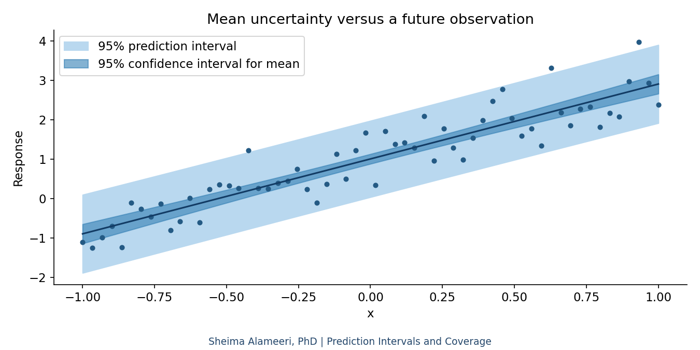
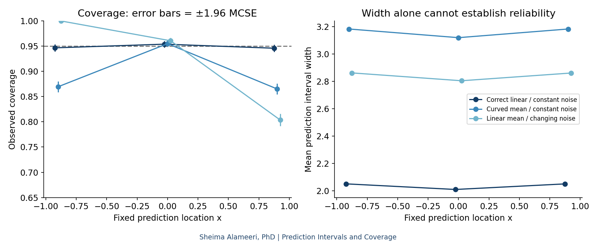

# Prediction Intervals and Coverage
**Author and maintainer: Sheima Alameeri, PhD**

A standalone educational experiment using synthetic data. Established statistical methods, not a new algorithm. No dissertation code or unpublished research is used.

## What does an interval describe?
A confidence interval here targets the conditional mean response at a fixed x. A prediction interval targets one independent future response and includes irreducible observation noise. Neither is a simultaneous band. Under a correctly specified linear mean, independent Gaussian errors of constant variance, and a full-rank design, the usual Student-t intervals have their nominal repeated-sampling coverage at fixed x.

For design row z, leverage h=zᵀ(XᵀX)⁻¹z, residual variance s²=SSE/(n−2), and q=t₀.₉₇₅,n−2: the mean interval is ŷ ± q s √h; the prediction interval is ŷ ± q s √(1+h).

## Experiment
We fit a straight line in all three scenarios: correct linear mean and constant noise; curved mean with constant noise; linear mean with changing noise. Each uses 4,000 independent training datasets. At each of three fixed x values, each replication generates one fresh future response. Coverage is the fraction captured; width is averaged over replications. No test responses tune the model.

The Monte Carlo standard error is √[ĉ(1−ĉ)/B]. Error bars ±1.96 MCSE quantify simulation error, approximately; they are not prediction intervals. At observed coverage 0 or 1, plug-in MCSE is zero but this does not prove zero simulation uncertainty; use a binomial boundary interval for inference there. Outcomes at different x share training data and are correlated, so we do not pool them as independent trials. Misspecification can distort local coverage even if average coverage looks satisfactory.




## Run
Python 3.11+: `pip install -r requirements.txt`, then `python run_tutorial.py`. Open `prediction_intervals.ipynb` in Jupyter (optional: `pip install jupyterlab`) for explanations and saved outputs. Run from repository root.

## Saved results
```text
4000 independent replications per scenario; checks passed.
Correct linear / constant noise | x=-0.9: coverage=0.9467, MCSE=0.0036, width=2.050
Correct linear / constant noise | x=0.0: coverage=0.9540, MCSE=0.0033, width=2.009
Correct linear / constant noise | x=0.9: coverage=0.9460, MCSE=0.0036, width=2.050
Curved mean / constant noise | x=-0.9: coverage=0.8695, MCSE=0.0053, width=3.182
Curved mean / constant noise | x=0.0: coverage=0.9550, MCSE=0.0033, width=3.119
Curved mean / constant noise | x=0.9: coverage=0.8652, MCSE=0.0054, width=3.182
Linear mean / changing noise | x=-0.9: coverage=1.0000, MCSE=0.0000, width=2.861
Linear mean / changing noise | x=0.0: coverage=0.9607, MCSE=0.0031, width=2.804
Linear mean / changing noise | x=0.9: coverage=0.8037, MCSE=0.0063, width=2.860
```

## Interpretation and limits
Compare coverage with 0.95 AND examine interval width. Wider is not automatically better; a narrow interval may miss frequently. The curved-mean scenario violates the fitted mean model; changing noise violates constant variance and can overcover low-noise locations while undercovering high-noise locations. This experiment stays within the training input range and does not establish extrapolation reliability. A seed makes results reproducible, not universally guaranteed.

Try changing sample size, noise, curvature, or seed. Repeat the experiment rather than drawing conclusions from one fitted dataset.

## References
- NIST/SEMATECH e-Handbook of Statistical Methods, least-squares estimation: https://www.itl.nist.gov/div898/handbook/pmd/section4/pmd431.htm
- SciPy Student t distribution documentation: https://docs.scipy.org/doc/scipy/reference/generated/scipy.stats.t.html

Code was newly prepared for this educational project with AI assistance; references credit established theory and software, not copied tutorial code.
